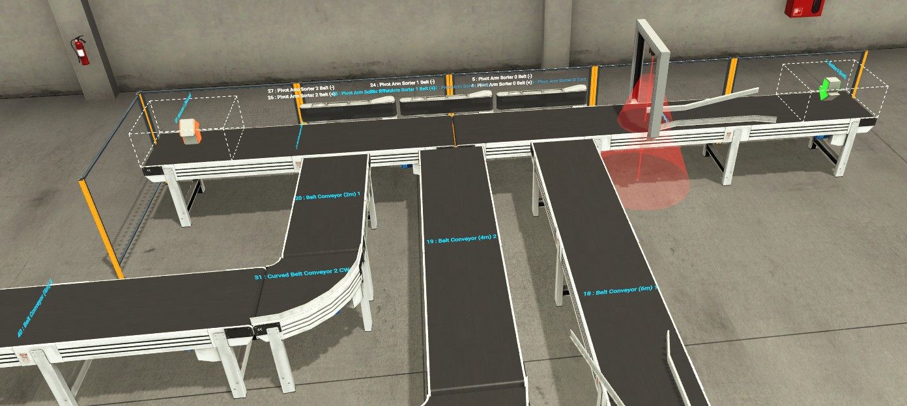
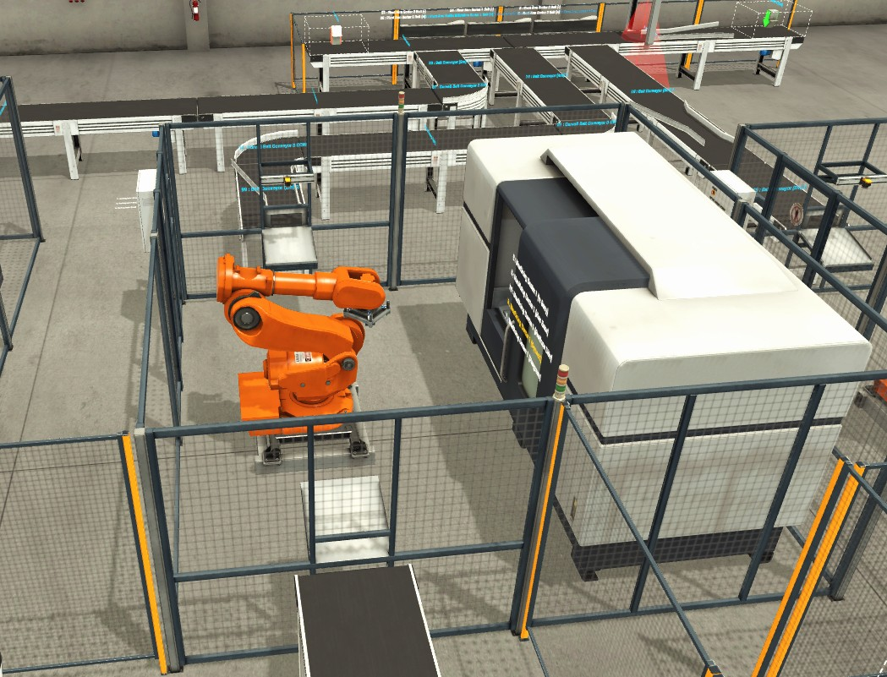
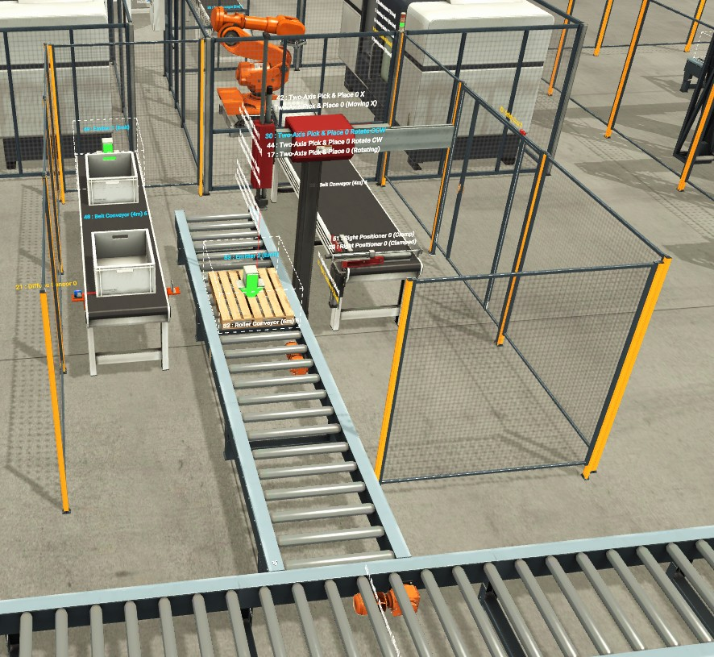
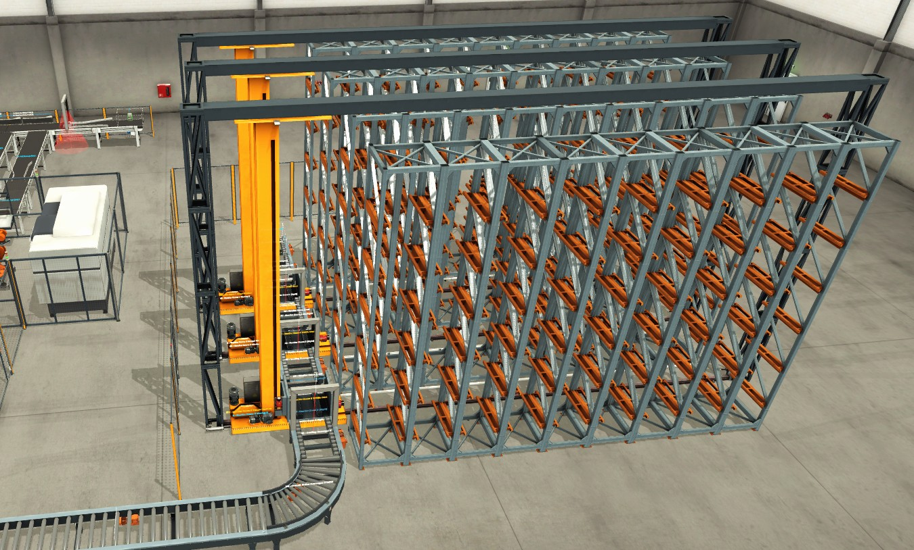

# Linia technologiczna – Factory I/O

Projekt symulowanej linii technologicznej wykonany w Factory I/O.

Projekt jest obecnie w trakcie realizacji. Układ obejmuje transport elementów za pomocą przenośników, ich sortowanie na podstawie koloru oraz przekazywanie do kolejnych stanowisk procesu.

W projekcie wykorzystano m.in.:
- przenośniki taśmowe i rolkowe,
- czujniki wykrywające elementy,
- mechanizmy sortujące,
- stanowisko z robotem przemysłowym,
- magazyn automatyczny.

## Widok linii technologicznej

## Sekcja sortowania

## Stanowisko z robotem

## Sekcja transportowa

